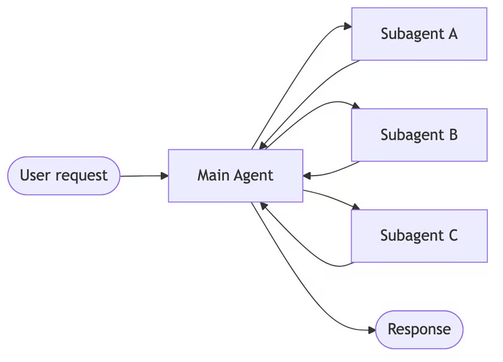

# AI 应用技术总结

> 只总结核心意思，具体代码建议看 [langchain](https://docs.langchain.com/) 等框架官网 

## LLM 大模型
- AI应用的大脑：用于思考，推理，生成内容，回答问题等
- 如GPT, Claude, DeepSeek, qianwen, GLM, kimi, doubao等

## AI Agent
Agent，直译叫代理，也叫智能体。普通对话模型是一问一答，能回答问题；而 Agent 不仅能回答问题，还能通过工具 Tools 办事，能通过 RAG 读内部资料，能通过 ReAct 不断反馈知道下一步要做什么，最终完成用户的目的。
- 说白了，就是普通对话模型能答，Agent 能办事。


## Harness coding
是驾驭编程。

## 记忆
## 结构化提示词
详细规定步骤的提示词，就叫**结构化提示词**，如下
```text
1. 简历标题要居中
2. 专业技能用表格展示
3. 项目经验要符合STAR法则
```

## command 命令
- 用短命令替换一段提示词的功能，就叫`command`
- 解决帮我们输入长提示词，不好输入和复用
- 动作：某些客户端如claude code支持把提示词固化到文件里，如`/command/hello.md` ，需要时通过类似快捷键的命令唤出, 如`/hello`，这种就叫`command`。
```text
-----
按要求写简历
-----

1. 帮我写简历
2. 简历标题要居中
3. 专业技能用表格展示
4. 项目经验要符合STAR法则
```

## 系统提示词 System Prompt
- 是比用户在输入框输入的`用户提示词`优先级更高的`系统提示词`。
- 解决：用户提示词过多过长，许多提示词被忽略，不生效。
- 动作：加系统提示词，某些客户端如claude code, cursor等，留了口子，可以在根目录定义`Claude.md`,`.cursorrules`等文件，来定义系统提示词。  如下最常见：
```text
请用中文回复我
```

## Metadata 元数据
- 是什么：给系统提示词md文件加`name`和`description`信息
- 

## 提示词工程
- 是通过自定义**系统提示词**，引导模型生成符合预期的内容
- 解决大模型**无引导、乱说话**的问题。
- 动作：在项目根目录创建如`claude.md`、`cursorrule.md`这样的 **规则文件**，来引导和约束模型的思考。


### SKILLs
- 是大模型留的口子，通过**文件的形式**，预先自定义好**系统提示词**，通过`/skill`接口调用，来引导和约束模型的思考。

## langchain LLM应用框架

### Context 上下文
- 每次调用 agent 时，模型调用的工具 Tools 需要`拿调用者的信息、配置、依赖等上下文信息`，就要靠 Context 上下文来传递。
- 特性：① 用户提问，调用服务端/chat接口，agent.invoke 时传入 context ② agent执行过程中只读，不可修改

```python
# 定义上下文
@dataclass
class Context:
    user_id: str
    user_role: str

# 在tool的runtime中获取user_id
@tool
def get_user_info(runtime: ToolRuntime[Context]) -> str:
    """Look up user info."""
    assert runtime.store is not None
    user_id = runtime.context.user_id
    user_role = runtime.context.user_role

agent = create_agent(
  'deepseek-flash',
  context_schema=Context
)
```

### State 短期记忆-当前agent会话内的状态数据共享
- 短期记忆，agent执行过程中的状态数据+messages历史消息。一个会话内有效
- thread_id一样，就可以共享state
```python
from langchain.agents import AgentState

# 创建自定义State
class CustomState(AgentState):
    count: Int

#定义函数工具
@tool
def update_count_tool(runtime: ToolRuntime):
  # 获取state中的tool
  prev_count = runtile.state.get('count', 0)

  update = {
    "count": prev_count + 1,
    "message": [
      ToolMessage(
        content="Successfully updated state"
        tool_call_id=runtime.tool_call_id
      )
    ]
  }
  return Command(update=update)

# 创建agent,传入state
agent = create_agent(
  'deepseek-flash',
  tools=[update_count_tool],
  checkpointer=InMemorySaver()
  state_schema=CustomState
  system_prompt="你是一个热心的助手，你需要调用工具记录模型调用次数"
)

# 调用模型
agent_config = {thread_id: 1}
response = agent.invoke(
  HumanMessage('Hi,我是小吴'),
  agent_config
)

for message in response["messages"]:
  print(message.pretty_print())

```
### Middleware 中间件
在agent执行 
### Human-in-the-loop HITL 循环中的人工确认


### 自定义中间件
如果Langchain 预定义中间件不满足我们业务，那咱就需要自定义中间件，有两种类型的自定义方式：
1. node-style 方式：
  - before_agent
  - before_model
  - after_model
  - after_agent
2. warp-style 方式：环绕包裹的方式
  - wrap_model_call：支持模型调用前后执行
  - wrap_tool_call：支持tool调用前后执行
3. class 类方式：可以重写多个 node-style 和 wrap-style 的中间件
  - 需要 class 继承 AgentMiddle, 然后在 class 内部写对应方式的中间件即可
  - 适合当某个功能需要多个中间件配合时

- 中间件跳转，可以在装饰器上面加 jump_to, 取值可以是['end', 'model', 'tools'], 比如 end 表示直接结束会话

### MCP 模型上下文协议
模型通过调用工具，就有了做事能力，现在不仅调用本地tool, 还可以调外部工具做事，只要外部工具遵循 MCP 协议，就能让模型调用。
- 两种方式调用：`stdIO` 与 `Streamable HTTP`

#### 自定义 MCP
**fastMcp**帮我们把普通函数装饰成遵循 mcp 协议的函数

### MultiAgent 多子 agent
有多种方式：[Multi-agent](https://docs.langchain.com/oss/python/langchain/multi-agent/index#why-multi-agent)
1. Subagents: 一个主 agent 协调多个子 agent, 所有 子agent 都通过 主agent。子agent 作为 主agent 的 tools 在适当时候干事。

2. Handoffs: 
  


### 思考，推理
模型层：作为大脑

### 执行


### 反馈

### 编排


### Ollama 本地部署

### python环境准备
#### 安装 UV


## RAG 检索增强生成-知识库问答
### RAG是什么
- 全称Retrieval-Augmented Generation，给LLM大模型在普通问答基础上，外挂（增强）一些知识库资料，供模型参考，从而更专业的，更能根据知识库具体的业务来回答（生成）用户问题。
- 文档地址:[langchain-Retrieval](https://docs.langchain.com/oss/python/deepagents/retrieval#retrieval-pipeline)
### 文档的解析
- langchain,文件解析
### 文档的切分
- 结构感知切分（适合markdown，语义段落准确，完整）
### 向量数据库
- Milvus 适用范围广，速度快，精准，适合小、中、大型项目

### RAG架构
- Two-step 架构 两步式
  - 在agent的before-model钩子里进行rag检索
    - 优点：速度快
    - 缺点：每次问答都经过知识库
- Agentic RAG 架构
  - 根据用户问题，按需检索知识库，与知识库无关就跳过知识库
    - 优点：按需检索知识库
    - 缺点：速度慢一点，首先经过LLM思考，是否调用知识库检索函数工具。


## langGraph 图
### langGraph vs langchain
- langGraph: 关注工作流的编排，自由控制/定制工作流的每一个细节：如节点Node和边Edge。
  - 优点： 自由度高
  - 缺点： 增加复杂度
  - 场景： 需要完全控制工作流的流程和细节，或复杂的Agent工作流等
  - 掌握了langGraph,就掌握了开发高复杂度、高可靠性Agent应用的能力，迈入高级AI应用工程师的门槛。

- langchain: 提供统一的AI应用相关api，底层基于langGraph实现Agent, 简化Agent创建和使用
  - 优点：方便和快捷
  - 缺点：灵活度不如langGraph,不能定制Agent内部流程和细节
  - 场景：简单LLM调用，或快速的Agent开发等


## SSE

- 优势：
  - 实时性高，能够实时推送数据给客户端
  - 断线重连
- 劣势：
  - 只能 GET，无法 POST传递token - 可自定义SSE
    - 解决：封装自定义SSE，MySSE 利用fetch readableStream 传递token
  - 不支持IE - 可自定义SSE
    - 解决：也是封装自定义SSE，后端不用动，仍然用SSE的header
